# Bedah Logika Low-Level: URL Router SAMIR iOS (CZSwiftRouterLib)

> **Dokumen Pendamping untuk:** [`02-navigation-fundamentals.html`](file:///Users/samir/Documents/Workspace/Chiron/courses/samir-mobile-ios/04-understanding-navigation/02-navigation-fundamentals.html)  
> **Tujuan:** Mengurai seluruh percabangan `if`, kondisi tersembunyi, prioritas parameter, hingga potensi *silent failure* dan fatal crash pada sistem navigasi router SAMIR.

---

## 1. Mengapa Kodenya Penuh dengan `if` dan Kondisional?

Di aplikasi monolitik biasa, membuka layar dilakukan sesederhana:
```swift
let vc = IDNewOCRViewController()
self.navigationController?.pushViewController(vc, animated: true)
```
Namun di SAMIR iOS, sistem menggunakan arsitektur **Decoupled URL Scheme Router** (`CZSwiftRouterLib`). Tujuannya agar:
1. Antar-modul (misal Beranda vs Pinjaman vs Auth) tidak saling import langsung.
2. Server bisa mendikte halaman mana yang harus dibuka (*Server-Driven Navigation* via JSON `jumpUrl`).
3. Deep link dari iklan (AppsFlyer) atau Push Notifikasi menggunakan jalur yang persis sama.

Konsekuensinya: Karena inputnya adalah **teks bebas (string URL)**, ada puluhan kemungkinan hal aneh yang bisa terjadi (URL rusak, karakter spasi, modul belum terdaftar, parameter hilang, atau typo). Seluruh `if` dalam pustaka ini adalah guardrail untuk menangani kemungkinan-kemungkinan tersebut.

---

## 2. Peta Seluruh Kondisi yang Mungkin Terjadi (Decision Matrix)

Berikut adalah ringkasan setiap kondisi yang dievaluasi dari awal pemanggilan sampai layar muncul:

| No | Tahap Pengecekan | Kondisi yang Terjadi | Keputusan / Aksi Sistem | Efek ke Pengguna |
|:---|:---|:---|:---|:---|
| **1** | Validasi Awal String | `urlString.count < 1` (String kosong `""`) | Langsung `return` | Navigasi hening, tidak ada respon. |
| **2** | Filter URL Rewrite | URL ada di kamus `filterRouters` | URL di-rewrite ke rute baru + param digabung | Diarahkan ke rute pengganti secara transparan. |
| **3** | URL Encoding | URL mengandung spasi / karakter ilegal | Dilakukan percent-encoding paksa (`alphanumerics`) | URL dinormalisasi agar tidak `nil`. |
| **4** | Parameter Konflik | Kunci sama di URL Query (`?step=1`) vs Dict `params` | Nilai di **Query String URL MENIMPA** nilai Dict | Nilai string URL yang diprioritaskan. |
| **5** | Validasi Komponen URL | Scheme atau Host kosong | `isValid == false`, router berhenti | Navigasi gagal status `.Forbidden` / `.NotFound`. |
| **6** | Pendaftaran Host Duplikat | Ada 2 modul mendaftarkan host yang sama | Terpicu `assert(!isDuplicateRouter)` | **CRASH SEKETIKA saat startup** di mode Debug! |
| **7** | Pencocokan Modul (Host) | Host tidak cocok dengan modul mana pun | Router Center tidak menemukan `matches` | Status `.NotFound` (404), navigasi hening. |
| **8** | Pencocokan Layar (Path) | Host cocok tapi Path tidak ada di modul | `CZRouterTable` mengembalikan `nil` | Status `.NotFound` (404), navigasi hening. |
| **9** | Tipe Handler Modul | Handler Sync vs Async | Dipanggil `handle()` sync atau closure async | UI ViewController disiapkan. |
| **10**| Guard Parameter Bisnis | Parameter penting hilang (misal `bizId == nil`) | `if let bizId = params?["bizId"]` gagal | **Silent Failure**: Halaman tidak pernah terbuka! |
| **11**| Resolusi Top UI | `UIViewController.cz.topViewController()` `nil` | `navigationController?.push` gagal | Layar tidak bergerak meski route sukses. |

---

## 3. Penjelasan Step-by-Step Per Logika & Tiap `if`

Mari kita bedah perjalanan sebuah URL dari awal dipanggil hingga ViewController tampil.

### Step 1: Pintu Masuk (`IDRouterManager` & `CZRouterCenter.perform`)
```swift
public func perform(_ urlString: String, params: [String: Any]?, closure: CZRouterHandlerClosure?) {
    // 🔍 IF #1: Pengecekan string kosong
    if urlString.count < 1 {
        return // Jika dikirim "", abaikan langsung tanpa error
    }
    
    // 🔍 PROSES #2: Filter URL (penerjemah alias)
    let filterUrl = self.filterRouterUrl(urlString)
    self.perform(CZRouterRequest().initWithUrlString(filterUrl, params: params), closure: closure)
}
```

---

### Step 2: Logika Rewrite URL (`filterRouterUrl`)
Fungsi ini bertindak seperti fitur *URL Rewrite* di web server (misal mengalihkan URL lama ke modul baru).

```swift
func filterRouterUrl(_ originalUrl: String) -> String {
    var absoluteUrl: String = originalUrl
    let urlArr: [String] = absoluteUrl.components(separatedBy: "?")
    let splitUrl: String = urlArr.first ?? ""
    
    // 🔍 IF #2: Apakah ada aturan filter DAN URL ini ada di daftar filter?
    if filterRouters.count > 0 && (filterRouters.keys.firstIndex(of: splitUrl) != nil) {
        let routerUrl: String = self.filterRouters[splitUrl] ?? ""
        let urlParams: String = urlArr.last ?? ""
        
        // 🔍 IF #3: Apakah URL asli membawa query parameter setelah tanda '?' ?
        if urlParams.count > 0 {
            // 🔍 IF #4: Apakah URL tujuan rewrite sudah punya tanda '?' ?
            if routerUrl.contains("?") {
                absoluteUrl = routerUrl.appending("&\(urlParams)") // Sambung pakai '&'
            } else {
                absoluteUrl = routerUrl.appending("?\(urlParams)") // Sambung pakai '?'
            }
        } else {
            // Jika tidak ada parameter tambahan, ganti string mentahnya
            absoluteUrl = absoluteUrl.replacingOccurrences(of: splitUrl, with: routerUrl)
        }
        return absoluteUrl
    }
    
    return originalUrl // Jika tidak ada aturan filter, pakai URL asli
}
```

#### 💡 Sample Kasus Nyata IF #4 (Query String Merging):
Bayangkan modul mendaftarkan aturan alias (`filterRouters`):
- **Alias A (Tanpa Query Bawaan):** `"samir://promo/diskon" -> "samir://repay/voucher"`
- **Alias B (Sudah Membawa Query):** `"samir://promo/lebaran" -> "samir://loan/apply?campaign=lebaran2026&utm=banner"`

Saat URL dieksekusi:
1. **Kasus 1: Target SUDAH Memiliki `?` (`contains("?") == true`):**
   - **URL Masuk:** `samir://promo/lebaran?userId=9988&source=facebook`
   - IF #4 mendeteksi tanda `?` pada URL target. Jika disambung dengan `?`, URL akan rusak ganda (`...apply?campaign=lebaran2026?userId=...`).
   - **Hasil:** Disambung dengan karakter `&` ➔ `samir://loan/apply?campaign=lebaran2026&utm=banner&userId=9988&source=facebook` ✅
2. **Kasus 2: Target BELUM Memiliki `?` (`contains("?") == false`):**
   - **URL Masuk:** `samir://promo/diskon?voucherId=VC100`
   - IF #4 mendeteksi target belum punya query string.
   - **Hasil:** Disambung pertama kali dengan tanda `?` ➔ `samir://repay/voucher?voucherId=VC100` ✅
3. **Kasus 3: URL Masuk TIDAK Membawa Parameter (`urlParams.count == 0`):**
   - **URL Masuk:** `samir://promo/diskon`
   - **Hasil:** Mengganti string mentah (`replacingOccurrences`) ➔ `samir://repay/voucher` ✅

---

### Step 3: Parsing URL & Penggabungan Parameter (`CZRouterRequest`)
Di tahap ini, teks diubah menjadi objek `URL` dan parameter dari Query String digabungkan dengan Dictionary.

```swift
func initWithUrlString(_ urlString: String, params: [String: Any]?) -> CZRouterRequest? {
    var url = URL(string: urlString)
    
    // 🔍 IF #5: Jika URL gagal dibentuk (misal ada spasi atau karakter non-ASCII)
    if url == nil {
        var encodeStr = ""
        let decoderStr = urlString.removingPercentEncoding
        // 🔍 IF #6: Jika string belum pernah di-encode, lakukan encoding paksa
        if urlString == decoderStr {
            encodeStr = urlString.addingPercentEncoding(withAllowedCharacters: CharacterSet.alphanumerics) ?? ""
        }
        url = URL(string: encodeStr)
    }
    
    self.url = url
    
    // 🔍 IF #7: Jika URL berhasil valid
    if let validUrl = url {
        return self.initWithURL(validUrl, params: params)
    }
    return nil
}
```

#### Aturan Tabrakan Parameter (`initParams`):
```swift
let totalParams = allParams.merging(items) { _, second in
    return second // ⚠️ 'second' adalah item dari URL Query string!
}
```
> **Aturan**: Jika Anda memanggil `perform("samir://auth/identity?step=2", params: ["step": "1"])`, maka nilai `step` yang menang adalah `"2"` (dari string URL).

---

### Step 4: Mekanisme Router Center Virtual (`CZRouterCenter.init` & `match`)

Banyak developer bingung saat melihat `init()` di `CZRouterCenter.swift`:
```swift
init() {
    routers = Array<CZRouter>()
    // Membuat router sapu jagat (cocok dengan scheme & host apa pun)
    currentRouter = CZRouter.initWithSchemeParttern("^\\S+$", withHostParttern: "^\\S+$")
    filterRouters = [String: String]()
    // Mendaftarkan dirinya sendiri (self) untuk menangani path apa pun
    currentRouter?.registerHandler(self, forPathParttern: "^/\\S+$")
}
```

**Kenapa arsitekturnya dibuat seperti ini?**
`CZRouterCenter` memakai pola **Composite / Gateway Handler**:
1. `currentRouter` bertugas memvalidasi bahwa format request memenuhi regex dasar (tidak kosong, ada `/` di path).
2. Jika lolos, ia memanggil method `handle()` milik `CZRouterCenter` sendiri.
3. Di dalam `handle()`, barulah `CZRouterCenter` melakukan loop terhadap seluruh router modul riil (`SamirAuthModule`, `SamirLoanModule`, dsb.).

#### 🔍 Bedah Regex `^\S+$` pada Gateway Virtual Router:
Mengapa `CZRouterCenter` memakai `^\S+$` untuk Scheme dan Host, serta `^/\S+$` untuk Path?
- `^` : Awal string (*Start of line*).
- `\S` : Karakter **non-whitespace** (apapun selain spasi, tab, atau baris baru).
- `+` : Minimal 1 karakter atau lebih (*Non-empty*).
- `$` : Akhir string (*End of line*).

**Fungsi Arsitektur:** Sebagai **Fail-Fast Boundary**. Router menolak URL rusak atau kosong seawal mungkin sebelum membebani CPU dengan pencocokan regex berlapis di setiap modul anak.

| Kategori | Contoh URL | Status | Alasan Evaluasi |
|:---|:---|:---|:---|
| **Diterima** | `samir://loan/confirm` | ✅ Lolos | Scheme `samir`, Host `loan`, Path `/confirm` seluruhnya non-whitespace. |
| **Diterima** | `samir://mine/setting` | ✅ Lolos | Seluruh komponen valid dan memiliki path berawalan `/`. |
| **Ditolak** | `samir:///confirm` | ❌ `.NotFound` | Host kosong (`""`), gagal `+` karena membutuhkan minimal 1 karakter. |
| **Ditolak** | `samir:// loan/confirm` | ❌ `.NotFound` | Host diawali karakter spasi, gagal karena spasi bukan `\S`. |
| **Ditolak** | `samir://loan` | ❌ `.NotFound` | Path kosong tanpa tanda `/`, gagal regex path `^/\S+$`. |

```swift
public func handle(_ router: CZRouterProtocol?) -> Any? {
    var response: CZRouterResponse? = nil
    
    // Melakukan iterasi ke semua modul bisnis yang terdaftar
    for (_, item) in self.routers.enumerated() {
        response = item.matches(router)
        // 🔍 IF #8: Begitu ada satu modul yang cocok (Success), langsung hentikan pencarian!
        if response?.status == .Success {
            return response
        }
    }
    
    // 🔍 IF #9: Jika tidak ada satu modul pun yang cocok
    if response == nil {
        response = CZRouterResponse.initWithStatus(.NotFound, request: router)
    }
    return response
}
```

---

### Step 5: Pencocokan Host & Path di Modul (`CZRouter.swift` & `CZRouterTable.swift`)

Saat sebuah modul (misal `SamirLoanModule`) mengevaluasi URL:
```swift
func matches(_ router: CZRouterProtocol?) -> CZRouterResponse? {
    // 🔍 IF #10: Validasi Scheme & Host (isValidRouter)
    if self.isValidRouter(router) == false {
        // Jika host modul ini adalah "loan", tapi URL meminta "auth", tolak langsung
        return CZRouterResponse.initWithStatus(.Forbidden, request: router)
    }
    
    var routerHandler: CZRouterBaseHandlerProtocol? = nil
    // Mencari path di tabel rute internal modul
    for (_, table) in self.tables.enumerated() {
        routerHandler = table.matches(router?.path ?? "")
        if routerHandler != nil { break }
    }
    
    // 🔍 IF #11: Apakah path ditemukan?
    if routerHandler != nil {
        let response = CZRouterResponse.initWithStatus(.Success, request: router)
        response.handler = routerHandler
        return response
    } else {
        // Host cocok ("samir://loan"), tapi path tidak ada ("/unknown")
        return CZRouterResponse.initWithStatus(.NotFound, request: router)
    }
}
```

#### Cara Mencocokkan String Path / Host (`CZRouter.match`):
```swift
class func match(_ parttern: String, content: String) -> Bool {
    // 🔍 IF #12: Jika string kosong, return false
    if parttern.count == 0 || content.count == 0 { return false }
    
    let patternPrefix = parttern.hasPrefix("^")
    let patternSuffix = parttern.hasSuffix("$")
    
    // 🔍 IF #13: Apakah pola berupa Regular Expression (ada ^ dan $)?
    if patternPrefix && patternSuffix {
        let regex = try! NSRegularExpression(pattern: parttern, options: .caseInsensitive)
        let number = regex.numberOfMatches(in: content, range: NSMakeRange(0, content.count))
        return number != 0
    }
    
    // Jika bukan regex, bandingkan teks case-insensitive biasa
    return content.lowercased() == parttern.lowercased()
}
```

---

### Step 6: Eksekusi Handler & Presentasi UI (`IDSamirLoanRouterHandler.swift`)

Setelah handler ditemukan, method `handle` milik modul bisnis dieksekusi:

```swift
func handle(_ router: CZRouterProtocol?) -> Any? {
    // 🔍 SWITCH CASE: Memetakan path ke fungsi pembuat ViewController
    switch router?.path {
    case "/confirm":
        openConfirmPage(router?.params)
    case "/creditAssess":
        openCreditAssess(router?.params)
    case "/voucherSelect":
        openVoucherSelect(router?.params)
    default:
        break
    }
    return nil
}
```

#### Kondisional Parameter Bisnis (`openConfirmPage`):
```swift
func openConfirmPage(_ params: [String: Any]?) {
    let doubleLoan = params?["doubleLoan"] as? String
    let backToHome = params?["backToHome"] as? Bool ?? true
    let isAutomaticLoan = params?["isAutomaticLoan"] as? Bool ?? false
    let repayInfo = params?["repayInfo"] as? IDLoanRepaidModel

    // 🔍 IF #14: Parameter Wajib 'bizId'
    if let bizId = params?["bizId"] as? String {
        // 🔍 IF #15: Pilihan Varian Tampilan Berdasarkan 'hideCut'
        if let hideCut = params?["hideCut"] as? String, hideCut == "1" {
            // 🔍 IF #16: Mencari ViewController teratas di layar
            if let source = UIViewController.cz.topViewController() {
                let vc = LoanConfirmViewController_Rx.regularReceivedAmount(...)
                source.navigationController?.pushViewController(vc, animated: true)
            }
        } else {
            // Varian reguler pinjaman
            if let source = UIViewController.cz.topViewController() {
                let vc = LoanConfirmViewController_Rx.regularLoanAmount(...)
                source.navigationController?.pushViewController(vc, animated: true)
            }
        }
    }
    // ⚠️ AWAS: Jika bizId == nil, seluruh blok diabaikan tanpa error log!
}
```

---

## 4. Contoh Kasus Nyata (Contoh Input -> Alur -> Hasil)

### Skenario A: Normal Flow (Sukses Buka Layar KTP)
* **Kode Pemanggil:**
  ```swift
  IDRouterManager.id_perfromWithURLString("samir://auth/identity?step=1")
  ```
* **Alur Eksekusi:**
  1. String tidak kosong (`count > 0`).
  2. Tidak ada aturan di `filterRouters` -> URL tetap.
  3. `CZRouterRequest` memecah: `scheme = "samir"`, `host = "auth"`, `path = "/identity"`, `params = ["step": "1"]`.
  4. `CZRouterCenter` mengirim ke `SamirAuthModule`.
  5. `SamirAuthModule` memeriksa: `scheme == "samir"` (Cocok), `host == "auth"` (Cocok).
  6. `CZRouterTable` mencocokkan `/identity` -> Ketemu `IDSamirAuthModuleRouterHandler`.
  7. Handler membaca `step = "1"`, membuat `IDNewOCRViewController`, dan melakukan `pushViewController`.
* **Hasil:** Halaman Foto KTP terbuka di layar ponsel.

---

### Skenario B: Silent Failure karena Typo pada Host
* **Kode Pemanggil:**
  ```swift
  IDRouterManager.id_perfromWithURLString("samir://atuh/identity") // Typo: 'atuh'
  ```
* **Alur Eksekusi:**
  1. `CZRouterCenter` meloop seluruh modul (`auth`, `loan`, `main`, `web`).
  2. Modul `auth` menolak karena hostnya `atuh` (mengembalikan status `.Forbidden`).
  3. Tidak ada modul yang cocok -> `CZRouterCenter` mengembalikan status `.NotFound`.
* **Hasil:** **Tidak ada crash, tapi tidak ada apa pun yang terjadi di layar.** Pemanggil tidak tahu kenapa tombol tidak merespon kecuali memeriksa callback closure.

---

### Skenario C: Silent Failure karena Parameter Bisnis Hilang
* **Kode Pemanggil:**
  ```swift
  IDRouterManager.id_perfromWithURLString("samir://loan/confirm") // Lupa mengirim bizId
  ```
* **Alur Eksekusi:**
  1. Routing teknis 100% SUKSES status `200 (.Success)`.
  2. Handler `IDSamirLoanRouterHandler.openConfirmPage` dipanggil.
  3. Baris `if let bizId = params?["bizId"] as? String` dievaluasi -> Hasilnya `nil` (`false`).
  4. Seluruh blok pembuatan controller dilewati!
* **Hasil:** URL benar, router sukses, namun **layar tidak pernah terbuka**.

---

### Skenario D: Fatal Crash saat Startup (Duplicate Host Trap)
* **Skenario:** Developer baru membuat modul `SamirPaymentModule` dan mendaftarkan router:
  ```swift
  let router = CZRouter.initWithSchemes(["samir"], withHostParttern: "loan") // Host "loan" sudah dipakai SamirLoanModule!
  CZRouterCenter.shared.addRouter(router)
  ```
* **Alur Eksekusi:**
  1. `CZRouterCenter.addRouter` mengecek `assert(!self.isDuplicateRouter(router!))`.
  2. Ditemukan bahwa host `"loan"` sudah ada di array `routers`.
* **Hasil:** **Aplikasi langsung CRASH SEKETIKA saat splash screen dijalankan**:
  ```text
  Fatal error: Duplicate router: Optional("loan")
  ```

---

## 5. Ringkasan Singkat untuk Diingat

1. **Format Standar Wajib**: `samir://[host]/[path]?[params]`
2. **Kueri URL Menang**: Jika ada param ganda, yang di string URL menimpa yang di Dictionary.
3. **Penyebab Terbanyak Navigasi Tidak Berjalan**:
   - Typo nama host atau path (mengakibatkan 404 hening).
   - Parameter wajib di handler bisnis (`bizId`, dsb.) tidak disertakan atau tipe datanya salah (bukan `String`).
   - Tidak ada `UINavigationController` aktif di layar saat router mencoba melakukan `.pushViewController()`.

---

## 6. Use Case Praktis: Screen-to-Screen & Callback Patterns

Router tidak hanya dipakai untuk deep link luar. Di arsitektur modular SAMIR, router adalah **alat komunikasi utama antar-layar di dalam aplikasi (in-app screen-to-screen navigation)**.

### Use Case 1: Screen-to-Screen TANPA Parameter (Navigasi Sederhana)
* **Kasus:** Dari Layar Profil Akun (`IDMinePersonalController`), pengguna ingin membuka Layar Pengaturan Aplikasi (`IDMineSettingController`).
* **Kode Pemanggil (Screen A):**
  ```swift
  // Menggunakan konstanta enum strongly-typed atau URL langsung
  let settingUrl = IDRouterSchemeConstants.Mine.setting.rawValue // "samir://mine/setting"
  IDRouterManager.id_perfromWithURLString(settingUrl)
  ```
* **Kode di Handler Modul (`IDSamirMineRouterHandler`):**
  ```swift
  case "/setting":
      openSettingPage(router?.params)
      break

  func openSettingPage(_ params: [String: Any]?) {
      let vc = IDMineSettingController()
      openVC(vc) // vc.cz.topViewController()?.navigationController?.pushViewController(vc, animated: true)
  }
  ```
* **Penjelasan:** Tidak ada data yang perlu dikirim. Handler cukup membuat instance ViewController tujuan dan melakukan `pushViewController`.

---

### Use Case 2: Screen-to-Screen DENGAN Parameter

#### Pola 2A: Parameter Primitif via Query String URL
Cocok untuk nilai sederhana (angka, string pendek, flag).
* **Kasus:** Dari Layar Login/Registrasi, pindah ke Layar Verifikasi OCR KTP pada langkah tertentu.
* **Kode Pemanggil (Screen A):**
  ```swift
  IDRouterManager.id_perfromWithURLString("samir://auth/identity?step=2&isEdit=1")
  ```
* **Kode di Handler (`IDSamirAuthModuleRouterHandler`):**
  ```swift
  func openIdentityPage(_ params: [String: Any]?) {
      let vc = IDNewOCRViewController()
      if let editable = params?["isEdit"] as? String {
          vc.isEdit = editable
      }
      if let step = params?["step"] as? String {
          vc.step = step
      }
      openVC(vc)
  }
  ```

#### Pola 2B: Parameter Objek / Model Kompleks via Dictionary `params`
Query URL string **tidak bisa** membawa objek Swift atau instance Model. Di sinilah parameter dictionary `params: [String: Any]?` digunakan.
* **Kasus:** Dari Beranda (`IDHomeViewController`), membuka Layar Konfirmasi Pinjaman (`LoanConfirmViewController_Rx`) dengan membawa model data pelunasan (`IDLoanRepaidModel`) dan ID transaksi.
* **Kode Pemanggil (Screen A):**
  ```swift
  let loanParams: [String: Any] = [
      "bizId": self.presenter.bizId ?? "",
      "doubleLoan": "0",
      "backToHome": true,
      "isAutomaticLoan": false,
      "repayInfo": self.presenter.repaidModel // 💡 Mengirimkan Objek Model Kompleks
  ]

  IDRouterManager.id_perfromWithURLString("samir://loan/confirm", params: loanParams)
  ```
* **Kode di Handler (`IDSamirLoanRouterHandler`):**
  ```swift
  func openConfirmPage(_ params: [String: Any]?) {
      let doubleLoan = params?["doubleLoan"] as? String
      let backToHome = params?["backToHome"] as? Bool ?? true
      let isAutomaticLoan = params?["isAutomaticLoan"] as? Bool ?? false
      let repayInfo = params?["repayInfo"] as? IDLoanRepaidModel // 💡 Casting ke Model Objek

      if let bizId = params?["bizId"] as? String {
          if let source = UIViewController.cz.topViewController() {
              let vc = LoanConfirmViewController_Rx.regularLoanAmount(
                  bizId: bizId,
                  doubleLoan: doubleLoan ?? "0",
                  backToHome: backToHome,
                  isAutomaticLoan: isAutomaticLoan,
                  repayInfo: repayInfo
              )
              source.navigationController?.pushViewController(vc, animated: true)
          }
      }
  }
  ```

---

### Use Case 3: Navigasi DENGAN Callback (Menerima Data Balikan)

Ketika Screen A membuka Screen B, dan Screen A butuh data kembali saat Screen B selesai (misal: memilih voucher atau menandatangani persetujuan), terdapat **2 jenis callback**:

#### Pola 3A: Callback Siklus Router (`CZRouterHandlerClosure`)
Digunakan oleh Screen A untuk mengetahui apakah proses pembukaan layar berhasil atau gagal secara teknis (misal untuk analitik atau menyembunyikan loading spinner):
```swift
IDRouterManager.id_perfromWithURLString("samir://web/open", params: webParams) { response in
    guard let routerResponse = response as? CZRouterResponse else { return }
    
    if routerResponse.status == .Success {
        print("✅ Layar web berhasil dibuka!")
    } else if routerResponse.status == .NotFound {
        print("❌ Halaman tidak ditemukan (404), tampilkan banner peringatan!")
    }
}
```

#### Pola 3B: Callback Data Layar via Delegate / Closure (Screen B mengembalikan data ke Screen A)
Karena router memisahkan dependensi langsung antar-class, Screen A mengirimkan **Closure** atau **Delegate Protocol** ke dalam kamus `params`.

##### Contoh Nyata di Codebase SAMIR (`IDNLoginViewController` -> `BaseWebViewController`):
1. **Screen A (Layar Login):** Membuka Web Syarat & Ketentuan, lalu menyuntikkan `self` sebagai delegate:
   ```swift
   // IDNLoginViewController.swift
   var routerParams = [String: Any]()
   routerParams["url"] = "https://m.samir.co.id/samir/privacy"
   routerParams["navTitle"] = "Syarat & Ketentuan"
   routerParams["delegate"] = self // 💡 Menyuntikkan ProtocolDidCloseAgreement

   IDRouterManager.id_perfromWithURLString("samir://web/open", params: routerParams)
   ```
2. **Handler ([`IDSamirWebRouterHandler.swift`](file:///Users/samir/Documents/Workspace/SAMIR/Mobile/Develop/samir-mobile-develop/ios/IDSamirLoan/Application/SamirWebViewModule/Classes/Router/IDSamirWebRouterHandler.swift#L28-L30)):**
   ```swift
   if let delegate = params["delegate"] as? ProtocolDidCloseAgreement {
       vc.delegate = delegate // Diteruskan ke BaseWebViewController
   }
   ```
3. **Screen B (`BaseWebViewController`):** Saat pengguna selesai membaca dan menekan tombol centang/tutup:
   ```swift
   self.delegate?.didCloseAgreement() // 📞 Memanggil balik Screen A
   self.navigationController?.popViewController(animated: true)
   ```
4. **Hasil di Screen A:**
   ```swift
   extension IDNLoginViewController: ProtocolDidCloseAgreement {
       func didCloseAgreement() {
           // Kotak checkbox persetujuan login otomatis tercentang!
           bottomView.checkBoxButton.setImage(R.image.privacy_checked(), for: .normal)
           self.clickCheckBox = true
       }
   }
   ```

##### Contoh Pola Callback Closure (Misal Memilih Voucher Diskon):
```swift
// Screen A (Layar Pengajuan Pinjaman)
let voucherParams: [String: Any] = [
    "onSelectVoucher": { [weak self] (voucher: IDVoucherModel) in
        print("User memilih voucher: \(voucher.title), potongan Rp\(voucher.amount)")
        self?.applyDiscount(voucher)
    }
]

IDRouterManager.id_perfromWithURLString("samir://loan/voucherSelect", params: voucherParams)
```
```swift
// Di Handler / Screen B (IDVoucherSelectViewController)
if let onSelect = params?["onSelectVoucher"] as? ((IDVoucherModel) -> Void) {
    vc.onSelectVoucher = onSelect
}

// Saat cell diklik di Screen B:
self.onSelectVoucher?(selectedItem)
self.navigationController?.popViewController(animated: true)
```

---

### Use Case 4: Navigasi Lintas Modul (Inter-Module Navigation) & Zero Compile-Time Coupling

Di arsitektur modular SAMIR iOS, modul pengirim (misal: `SamirLoginModule` atau `SamirMineModule`) **sama sekali tidak meng-import** modul target (misal: `SamirAuthModule`).

#### 1. THE "WHY" (Arsitektur & Motivasi)
- **Zero Direct Import (Anti-Circular Dependency):** `SamirLoginModule` tidak tahu-menahu keberadaan kelas `IDNewOCRViewController`. Keduanya hanya berinteraksi melalui URI Scheme terpusat di [`IDRouterConstants.swift`](file:///Users/samir/Documents/Workspace/SAMIR/Mobile/Nexus/samir-mobile-nexus/ios/IDSamirLoan/Application/SamirRouterModule/Classes/IDRouterConstants.swift#L10-L53).
- **Independensi Kompilasi:** Perubahan layout atau logic pada layar KTP OCR di `SamirAuthModule` tidak memicu *recompilation cascade* pada modul Login maupun modul lainnya.
- **Unified Navigation Bus:** Navigasi internal antar-modul, Server-Driven push (`jumpUrl`), notifikasi APNs, dan Deep Link eksternal (AppsFlyer) menggunakan jalur eksekusi yang 100% konsisten.

#### 2. THE TRIGGER & CHAIN REACTION (Contoh Nyata di Production)
- **Trigger:** Pengguna selesai verifikasi OTP di [`CodeViewV2Controller.swift`](file:///Users/samir/Documents/Workspace/SAMIR/Mobile/Nexus/samir-mobile-nexus/ios/IDSamirLoan/Application/SamirLoginModule/Classes/IDViewcontroller/V2/CodeViewV2Controller.swift#L560) dan terdeteksi wajib verifikasi KTP (`checkToKTP() == true`).
- **Alur Eksekusi:**
  1. **Caller (Login Module):** `CodeViewV2Controller` memicu `IDRouterManager.id_perfromWithURLString(IDRouterSchemeConstants.Auth.identity.rawValue)` dengan string `"samir://auth/identity"`.
  2. **Router Center (Mediator):** [`CZRouterCenter.shared.perform`](file:///Users/samir/Documents/Workspace/SAMIR/Mobile/Nexus/samir-mobile-nexus/ios/IDSamirLoan/Application/CZSwiftRouterLib/Classes/CZRouterCenter.swift#L74-L81) menerima request, memvalidasi regex `^\S+$`, lalu mencocokkan host `"auth"` ke instance [`IDSamirAuthModule`](file:///Users/samir/Documents/Workspace/SAMIR/Mobile/Nexus/samir-mobile-nexus/ios/IDSamirLoan/Application/SamirAuthModule/Classes/IDModule/IDSamirAuthModule.swift#L26).
  3. **Module Table:** `IDSamirAuthModule` meneruskan ke [`IDSamirAuthModuleRouterHandler`](file:///Users/samir/Documents/Workspace/SAMIR/Mobile/Nexus/samir-mobile-nexus/ios/IDSamirLoan/Application/SamirAuthModule/Classes/IDRouter/IDSamirAuthModuleRouterHandler.swift#L22).
  4. **Handler Execution:** Handler mengevaluasi `switch router.path ➔ case "/identity": openIdentityPage()`.
  5. **UI Presentation:** `openIdentityPage` menginisialisasi controller internal [`IDNewOCRViewController`](file:///Users/samir/Documents/Workspace/SAMIR/Mobile/Nexus/samir-mobile-nexus/ios/IDSamirLoan/Application/SamirAuthModule/Classes/IDRouter/IDSamirAuthModuleRouterHandler.swift#L55), lalu menjalankan `UIViewController.cz.topViewController()?.navigationController?.pushViewController(vc, animated: true)`.

#### 3. MERMAID SEQUENCE DIAGRAM

```mermaid
sequenceDiagram
    autonumber
    participant LoginVC as CodeViewV2Controller<br/>(SamirLoginModule)
    participant RouterMgr as IDRouterManager<br/>(SamirRouterModule)
    participant Center as CZRouterCenter<br/>(CZSwiftRouterLib)
    participant AuthMod as IDSamirAuthModule<br/>(CZRouter: host="auth")
    participant Handler as IDSamirAuthModuleRouterHandler<br/>(SamirAuthModule)
    participant OCRVC as IDNewOCRViewController<br/>(SamirAuthModule UI)

    Note over LoginVC,OCRVC: Navigasi Lintas Modul: SamirLoginModule ➔ SamirAuthModule

    LoginVC->>RouterMgr: id_perfromWithURLString("samir://auth/identity")
    RouterMgr->>Center: perform("samir://auth/identity", params: nil)
    
    rect rgb(20, 35, 55)
        Note over Center: Parsing URL & Host Matching
        Center->>Center: match(request) ➔ Host "auth" cocok
        Center->>AuthMod: matches(request)
    end

    AuthMod->>Handler: handle(routerRequest)
    
    rect rgb(20, 45, 30)
        Note over Handler,OCRVC: Resolusi Controller Internal Modul Target
        Handler->>Handler: switch router.path ➔ case "/identity"
        Handler->>OCRVC: init()
        Handler->>OCRVC: topViewController.navigationController.pushViewController(animated: true)
    end

    Note over LoginVC,OCRVC: Modul Login sama sekali tidak meng-import kelas IDNewOCRViewController
```




