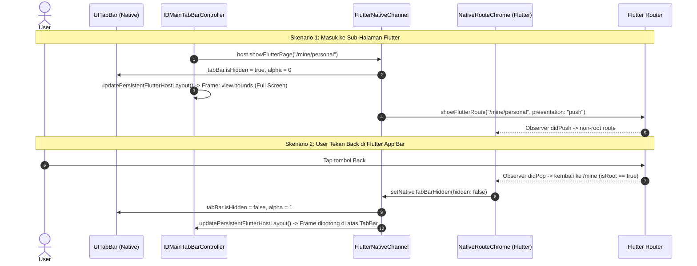
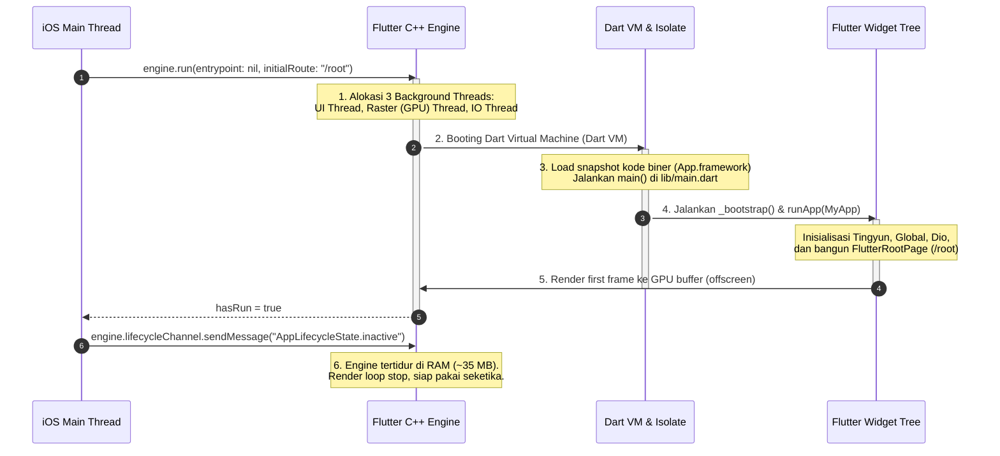
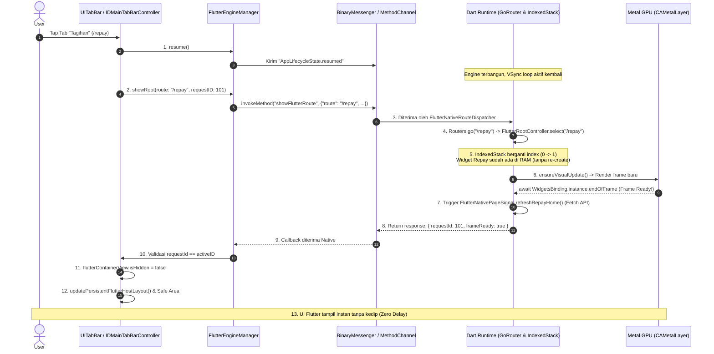

# 05 — Arsitektur Navigasi Hybrid TabBar & Flutter Persistent Host

> **Dokumen Modul:** [`05-hybrid-tabbar-navigation.html`](file:///Users/samir/Documents/Workspace/Chiron/courses/samir-mobile-ios/04-understanding-navigation/05-hybrid-tabbar-navigation.html)  
> **Modul Kurikulum:** Level 4 — Understanding Navigation  
> **Target Audiens:** Middle to Senior iOS / Mobile Engineer  
> **Cakupan Kode:** `IDMainTabBarController.swift`, `FlutterEngineManager.swift`, `FlutterNativeChannel.swift`, `FlutterNativeChannel+route.swift`, `flutter_native_route_dispatcher.dart`, `native_route_chrome.dart`, `flutter_root_page.dart`

---

## 1. Ikhtisar & Koreksi Konseptual

Di aplikasi SAMIR Mobile iOS, sekilas terlihat seolah-olah Native dan Flutter sama-sama memiliki bottom navigation bar (TabBar). Namun pada implementasi sebenarnya:

> **Fakta Arsitektur:** **Hanya ada 1 TabBar fisik di layar, yaitu Native `UITabBar`**.

Aplikasi menggunakan pola arsitektur **Single Persistent Flutter Host (Overlay Pattern)**:
- **`UITabBarController` Native** bertindak sebagai master container utama dengan 3 tab item:
  - Tab 0: `IDHomeViewController` (**Native UIKit murni**)
  - Tab 1: `IDRepayViewController` (**Native Sentinel / Placeholder VC**)
  - Tab 2: `IDMineViewController` (**Native Sentinel / Placeholder VC**)
- **Instance Tunggal `FlutterEngine` & `SamirFlutterViewController`** dijalankan sejak awal aplikasi (*prewarmed*).
- View Flutter tersebut diletakkan di dalam `flutterContainerView` dan disisipkan di atas view native tetapi **tepat di bawah `tabBar`**:
  ```swift
  view.insertSubview(flutterContainerView, belowSubview: tabBar)
  view.bringSubviewToFront(tabBar)
  ```
- Di sisi Flutter, halamannya tidak merender bottom navigation bar tersendiri, melainkan menampilkan kontainer `IndexedStack` yang memuat `MineHomePage` (`/mine`) dan `RepayHomePage` (`/repay`).

---

## 2. Mengapa Arsitektur Ini Dipilih? (Tradeoff Analysis)

| Dimensi | Pendekatan Multi-Engine (Tab Terpisah) | Pendekatan Single Persistent Host (SAMIR iOS) |
| :--- | :--- | :--- |
| **Konsumsi Memori (RAM)** | ❌ **Boros.** Butuh 2–3 `FlutterEngine` aktif (~35–45 MB per engine = total > 100 MB). | ✅ **Hemat.** Hanya 1 `FlutterEngine` dipakai bersama (~35 MB overhead tetap). |
| **Kecepatan Switch Tab** | ⚠️ Lambat jika engine dibuat *on-demand*, atau boros baterai jika semua standby. | ✅ **Instan.** Flutter hanya mengganti index di `IndexedStack`. |
| **Native Look & Feel** | ⚠️ Sulit menyelaraskan haptic feedback, safe-area layout, dan animasi tab bar iOS jika dirender di Flutter. | ✅ **100% Native iOS `UITabBar`** dengan transisi native Apple standar. |
| **Kompleksitas Sinkronisasi** | ⚠️ Tiap engine punya isolate Dart terpisah; sinkronisasi state antar-tab sangat rumit. | ⚠️ Butuh koordinasi view geometry (`updatePersistentFlutterHostLayout`) & bridging router manual. |

---

## 3. Pembedahan `showRoot` vs `showPage`

Dua method ini memiliki tanggung jawab arsitektural yang berbeda secara mendasar:

```
                          ┌───────────────────────────┐
                          │   FlutterEngineManager    │
                          └─────────────┬─────────────┘
                                        │
                 ┌──────────────────────┴──────────────────────┐
                 ▼                                             ▼
       showRoot(route, reqId)                      showPage(route, "push")
       ──────────────────────                      ───────────────────────
       • Ganti Tab Root Flutter                    • Buka Sub-Halaman Baru
       • Target: IndexedStack                      • Target: Navigator Stack
       • Sinkron (tunggu frameReady)               • Asinkron (Fire & Forget)
       • requestID anti race-condition             • TabBar native disembunyikan
       • TabBar native tetap tampil                • Contoh: /mine/personal
       • Contoh: /mine atau /repay
```

### A. `FlutterEngineManager.shared.showRoot`
Digunakan ketika user menekan tab bar native (Tagihan atau Saya).
1. **Tidak Menumpuk History:** Mengubah `FlutterRootController.selectedPath` di Flutter yang memicu render pada `IndexedStack`.
2. **Anti-Flicker (`frameReady`):** Native tidak langsung menampilkan view Flutter. Flutter merender frame terlebih dahulu:
   ```dart
   WidgetsBinding.instance.ensureVisualUpdate();
   await WidgetsBinding.instance.endOfFrame;
   ```
   Setelah frame selesai digambar GPU, Flutter membalas `{ frameReady: true, requestId: id }`. Baru saat itulah `flutterContainerView.isHidden = false` dipasang di native.
3. **Anti-Race Condition (`requestID`):** Menggunakan monotonic integer counter statis `nextFlutterRootRequestID`. Jika user menekan Tagihan &rarr; Saya &rarr; Tagihan dalam tempo kilat, respons render dari tab "Saya" yang datang terlambat akan ditolak karena ID-nya tidak cocok dengan `flutterRootRequestID` aktif.

### B. `FlutterEngineManager.shared.showPage`
Digunakan saat native ingin membuka sub-halaman formulir/detail di Flutter:
```swift
host.showFlutterPage("/mine/personal", presentation: "push")
```
1. **Navigasi Stack:** Memanggil `Routers.push(route)` di Flutter.
2. **Otomatis Sembunyikan TabBar:** `NativeRouteChrome` di Flutter mendeteksi perpindahan ke rute non-root, lalu mengirim channel event `setNativeTabBarHidden(true)`. Native mengubah `tabBar.isHidden = true` dan memperluas frame Flutter menjadi layar penuh (`view.bounds`).
3. **Nilai `presentation`:**
   - `"push"` (default): Animasi slide horizontal standar ke stack navigator.
   - `"replace"`: Menggantikan halaman saat ini (`Routers.go`) tanpa menumpuk tombol Back.

### C. 💡 Mental Model Kunci: Analogi `hidesBottomBarWhenPushed` iOS Native

Cara paling sederhana dan intuitif memahami perbedaan ini dari sudut pandang iOS Engineer:

> **Ringkasan Mental Model:**  
> - **`showRoot` (Mode Tab):** Karena pengguna masih berada di level tab utama, mereka **masih membutuhkan TabBar native** untuk berpindah tab &rarr; TabBar **TIDAK di-hide**, dan tinggi layar Flutter dibatasi tepat di atas TabBar.
> - **`showPage` (Mode Halaman Anak / Full-Screen):** Pengguna masuk ke halaman detail/formulir, sehingga ekspektasi UX adalah **tampilan layar penuh** &rarr; TabBar native **WAJIB di-hide**, dan frame Flutter diperluas 100% memenuhi layar (`view.bounds`). Navigasi kembali diserahkan ke tombol Back di AppBar.

Pada aplikasi iOS UIKit konvensional, perilaku `showPage` ini setara persis dengan menyetel:
```swift
childViewController.hidesBottomBarWhenPushed = true
```
Namun karena Flutter berjalan di atas satu View Controller persisten yang sama (*Single Persistent Flutter Host*), efek tersebut disimulasikan secara dinamis melalui sinyal Platform Channel `setNativeTabBarHidden = true`.

---

## 4. Mekanisme Dynamic Chrome & TabBar Visibility

Perhatikan alur visibilitas tab bar di file `IDMainTabBarController.swift` dan `FlutterNativeChannel+route.swift`:



---

## 5. Mengapa `showFlutterPage` di TabBar Hanya Menerima `/mine`?

Pada `IDMainTabBarController.swift:L169-L183`:
```swift
public func showFlutterPage(_ route: String, presentation: String = "push") {
    guard let tabViewControllers = viewControllers,
          tabViewControllers.indices.contains(2) else { return }
    let mineTab = tabViewControllers[2]
    selectedViewController = mineTab
    FlutterNativeChannel.shared.nativeTabBarHidden = true
    currentFlutterRoot = "/mine"
    ...
    FlutterEngineManager.shared.showPage(route, presentation: presentation)
}
```

Alasan desain bisnis:
1. **Satu-satunya sub-halaman Flutter dari luar adalah milik Tab "Saya":** Halaman seperti `/mine/personal` (Info Pribadi & Auth) adalah modul di bawah Tab Saya. Jika user membuka halaman ini lalu menekan tombol Back sampai habis, konteks yang harus tampil adalah Tab "Saya".
2. **Tab "Tagihan" (`/repay`) adalah Single Page Tab:** Halaman tagihan di Flutter tidak memiliki sub-alur Flutter anak. Transaksi pinjaman, pelunasan, pembayaran VA, dan rincian bunga di-*delegate* kembali ke modul Native (`IDRouterManager`) atau WebView H5 (`IDBusinessWebViewController`).

---

## 6. Peta Komunikasi Lengkap (Navigasi Dua Arah)

### A. Native &rarr; Flutter
1. **Tab Switch:** `IDMainTabBarController.switchFlutterRoot(to:)` &rarr; `FlutterEngineManager.showRoot` &rarr; MethodChannel `"showFlutterRoute"` (`presentation: "root"`).
2. **Sub-Page Navigation:** `IDSamirMineRouterHandler` &rarr; `IDMainTabBarController.showFlutterPage` &rarr; MethodChannel `"showFlutterRoute"` (`presentation: "push"`).
3. **Data Refresh Signals:** `FlutterEngineManager.refreshMineHome()` & `refreshRepayHome()`.

### B. Flutter &rarr; Native
1. **Buka Rute Native / Scheme / External:** `FlutterNativeChannelRoute.openNativeRoute(url, params)` &rarr; `FlutterNativeChannel+route.swift` mengevaluasi:
   - External URL / Medsos: `UIApplication.shared.open`
   - Layanan H5 Web: `IDBusinessWebViewController.loadUrlWithAuth`
   - Aksi Native: `customerAction`, `repayLoginAction`, `jumpDisclaimerPopup`
   - Native Router Scheme: `IDRouterManager.id_perfromWithURLString`
2. **Tutup Halaman Flutter:** `FlutterNativeChannelRoute.closeFlutterPage()` &rarr; Native memanggil `topViewController?.navigationController?.popViewController()` atau `dismiss()`.
3. **Kontrol TabBar:** `FlutterNativeChannelRoute.setNativeTabBarHidden(hidden)`.

---

## 7. Gotchas & Debugging Checklist

1. **TabBar Hilang Setelah Kembali dari Flutter:**
   - *Penyebab:* Callback observer di Flutter tidak terpanggil atau route name tidak terdaftar di `RootRoutes.tabPaths`.
   - *Mitigasi:* Pastikan rute root terdaftar di `RootRoutes.paths` dan panggil `prepareNativeChromeForTabSelection()` setiap kali tab native dipilih.
2. **Layar Flutter Kosong (Blank/Stuck):**
   - *Penyebab:* Lifecycle engine masih dalam status `inactive` atau request ID tidak sinkron dengan response completion.
   - *Mitigasi:* Periksa apakah `FlutterEngineManager.shared.resume()` dipanggil sebelum `showFlutterRoute`.
3. **Safe Area Inset Terpotong:**
   - *Penyebab:* Perhitungan safe area guide native tidak dikirim ke Flutter saat tinggi tab bar berubah.
   - *Mitigasi:* Verifikasi fungsi `updatePersistentSafeArea(top:bottom:)` di `SamirFlutterViewController`.

---

## 8. Pembedahan Teknis Engine & Host Invariants (Deep Dive Inisialisasi)

Bagian ini merangkum pembedahan teknis mendalam terhadap detail konfigurasi dan runtime yang sering menjadi pertanyaan arsitektur pada `FlutterEngineManager.swift` dan `pubspec.yaml`:

### A. Mengapa Bundle Identifier Flutter Berbeda? (`iosBundleIdentifier` di `pubspec.yaml`)
Pada `flutter/pubspec.yaml`:
```yaml
  module:
    androidX: true
    androidPackage: com.sahabatmikro.flutter_module
    iosBundleIdentifier: com.sahabatmikro.flutterModule
```
1. **Identitas Modul Add-to-App:** Properti `module:` menegaskan bahwa project Flutter ini adalah *embedded module*, bukan aplikasi standalone.
2. **Kompilasi Wrapper iOS (`.ios/`):** Saat Flutter toolchain membangun wrapper CocoaPods di folder ephemeral `.ios/`, nilai `com.sahabatmikro.flutterModule` digunakan sebagai `CFBundleIdentifier` untuk modul framework Flutter tersebut.
3. **Mencegah Tabrakan Bundle ID:** Identifier ini sengaja dibedakan dari Bundle ID aplikasi native utama (`IDSamirLoan`, misal `com.sahabatmikro.id` / `com.samir.loan`) agar tidak terjadi *bundle collision* di build system Apple/Xcode saat framework di-link melalui `podhelper.rb`.

### B. Misteri `"samir_single_flutter_engine"`: Mengapa Tidak Ditemukan di Flutter?
Pada `FlutterEngineManager.swift`:
```swift
private let engine = FlutterEngine(name: "samir_single_flutter_engine")
```
1. **Host-Side Identifier (Native Runtime):** String ini adalah argumen konstruktor bawaan `FlutterEngine(name: String)` dari framework iOS (`FlutterEngine.h`).
2. **Hanya Berlaku di Sisi Native iOS:** Nilai ini **tidak pernah diekspos atau dikirim ke isolate Dart**.
3. **Tujuan Utama:**
   - **Thread Profiling & Tracing:** Flutter Engine menggunakannya untuk menamai thread internal C++ (misal `io.flutter.1.ui`, profiler trace) pada Xcode Debugger, Instruments, dan crash reports.
   - **Key Identifikasi:** Berguna jika aplikasi menggunakan `FlutterEngineGroup` atau cache engine (`FlutterEngineCache`) untuk membedakan instans engine yang berjalan di memory. Di sini dinamai `samir_single_flutter_engine` untuk menegaskan arsitektur *Single Shared Engine*.

### C. Anatomi `SamirFlutterViewController`: Mengapa Terlihat "Empty View"?
```swift
public final class SamirFlutterViewController: FlutterViewController
```
1. **Bukan Empty View:** Terlihat kosong di kode Swift karena tidak menambahkan komponen UIKit standar (`UILabel`, `UIButton`, dll). Seluruh piksel visual dirender langsung oleh Flutter Engine di atas canvas grafis GPU via **`CAMetalLayer`** (Metal surface).
2. **Tanggung Jawab Khusus Subclass:**
   - **Anti-Flicker (`backgroundColor`):** Menyetel background ke `#F5F5F5` (abu-abu muda) untuk mencegah kedipan hitam/putih sesaat sebelum frame pertama Flutter selesai digambar.
   - **Bypass UIKit Layout Insets:** Menyetel `edgesForExtendedLayout = [.top, .bottom]` dan `extendedLayoutIncludesOpaqueBars = true` agar surface Flutter memenuhi container tanpa intervensi layout otomatis UIKit.
   - **Safe Area Dinamis (`updatePersistentSafeArea`):** Meneruskan kalkulasi safe area insets khusus container persistent saat status bar atau header berubah.
   - **Sinkronisasi Status Bar (`setNativeStatusBarOverlayHidden`):** Mengontrol visibilitas status bar overlay native (tag 100) saat tab Flutter aktif.
3. **Siapa Saja Konsumennya?**
   - **`FlutterEngineManager`:** Menginstansiasi dan menyimpannya sebagai singleton (`sharedViewController()`).
   - **`IDMainTabBarController`:** Menempelkan view-nya ke dalam `flutterContainerView` (`installPersistentRoot`).
   - **`FlutterNativeChannel+route.swift`:** Mengecek `persistentRootViewController` untuk menentukan konteks navigasi modal / push-pop.

### D. Inisialisasi `initialRoute: "/root"` (Cold-Start Prewarm)
Pada `FlutterEngineManager.swift`:
```swift
hasRun = engine.run(withEntrypoint: nil, initialRoute: "/root")
```
1. **Target Rute Flutter:** Di sisi Flutter (`routers.dart` dan `route_paths.dart`), rute `"/root"` diarahkan ke `FlutterRootPage`.
2. **Struktur `IndexedStack`:** `FlutterRootPage` membungkus `MineHomePage` (`/mine`) dan `RepayHomePage` (`/repay`) secara bersamaan.
3. **Mengapa Di-hardcode di Startup?**
   - Saat aplikasi melakukan `prewarm()` di startup native (`IDSamirMainModule`), engine langsung mem-booting tree `/root` dan menginisialisasi Dart isolate serta routing tree ke memori.
   - Saat pengguna kemudian mengetuk tab "Tagihan" atau "Saya" di `IDMainTabBarController`, halamannya **langsung muncul secara instan tanpa jeda rendering awal (zero cold-start latency)**.

### E. Protokol `lifecycleChannel` & State Baku (`AppLifecycleState.resumed` / `.inactive`)
```swift
engine.lifecycleChannel.sendMessage("AppLifecycleState.resumed")
engine.lifecycleChannel.sendMessage("AppLifecycleState.inactive")
```
1. **Channel Bawaan Framework:** `engine.lifecycleChannel` adalah `FlutterBasicMessageChannel<String>` resmi bawaan Flutter (`"flutter/lifecycle"`).
2. **Bukan String Bebas:** String `"AppLifecycleState.resumed"` dan `"AppLifecycleState.inactive"` adalah **protokol baku Flutter framework** (sesuai enum Dart `AppLifecycleState`). Jika dikirim string sembarang, Flutter tidak akan memproses perubahan lifecycle.
3. **Tujuan Efisiensi Daya & Baterai:**
   - Dalam pola persistent host, view Flutter tidak pernah di-destroy saat user berpindah ke tab native (Beranda).
   - Mengirim `"AppLifecycleState.inactive"` mematikan render loop, timer animasi, dan ticker Flutter saat tab native aktif, sehingga **menghemat CPU & baterai**.
   - Begitu user kembali ke tab Flutter, pengiriman `"AppLifecycleState.resumed"` membangunkan render loop kembali.

### F. Filosofi `precondition` vs Clean Architecture: Fail-Fast & Invariant Enforcement
```swift
precondition(
    hasRun,
    "FlutterEngineManager.prewarm() must run before installing the Flutter host"
)
```
1. **Cara Kerja `precondition` di Swift:**
   - Mengevaluasi kondisi logis. Jika `false`, aplikasi akan **crash seketika (fatal error)** baik di mode **Debug maupun Release**.
   - Berbeda dari `assert` yang dinonaktifkan di build Release, `precondition` menjamin kepatuhan runtime (*hard invariant*).
2. **Kesesuaian dengan Clean Architecture:**
   - **Menjunjung Tinggi Design by Contract (DbC) & Fail-Fast:** Dalam arsitektur modular, dependensi siklus hidup antar modul (Engine harus berjalan sebelum Host ViewController dipasang) adalah sebuah *system invariant*. Membiarkan aplikasi berjalan dalam state cacat (*undefined/corrupted state*) melanggar integritas arsitektur.
   - **Bedakan Programmer Error vs Recoverable Error:**
     - *Programmer Invariant Violation* (kesalahan urutan inisialisasi di kode): Tepat menggunakan `precondition` / `fatalError` agar terdeteksi sejak awal dan tidak menimbulkan bug hantu di produksi.
     - *Runtime / Recoverable Error* (kegagalan jaringan, payload JSON salah, user cancel): Wajib menggunakan `Error`, `Result`, atau `do-catch`, **bukan** `precondition`.
3. **Contoh Penggunaan Umum:**
   ```swift
   // Memastikan parameter konfigurasi wajib telah disuplai saat dependency didaftarkan
   final class SecureStorageService {
       private let serviceIdentifier: String
       
       init(identifier: String) {
           precondition(!identifier.isEmpty, "Service identifier cannot be empty.")
           self.serviceIdentifier = identifier
       }
   }
   ```

---

## 9. Pembedahan Siklus Hidup & Urutan Proses di Balik Layar (Under-the-Hood Sequence)

Bagian ini menguraikan secara mendalam bagaimana Flutter Engine berinteraksi dengan runtime iOS, apa saja yang dilakukan `prewarm()` di tingkat thread & memori, serta alur milidetik di balik layar saat layar Flutter dimuat atau dibuka oleh pengguna.

### A. Konsep Siklus Hidup (Lifecycle) Flutter di Host Native
Flutter pada dasarnya bukanlah kumpulan View UIKit standar, melainkan sebuah **mesin rendering grafis mandiri** yang menggambar seluruh pikselnya secara otonom di atas permukaan **`CAMetalLayer`** (Metal GPU pada iOS).

```
┌────────────────────────────────────────────────────────┐
│                      iOS System                        │
│                 (Main Thread / UIKit)                  │
└───────────────────────────┬────────────────────────────┘
                            │
               lifecycleChannel.sendMessage
                            │
      ┌─────────────────────┴─────────────────────┐
      │ "AppLifecycleState.inactive"              │ "AppLifecycleState.resumed"
      ▼                                           ▼
┌───────────────────────────┐               ┌───────────────────────────┐
│     FLUTTER ENGINE        │               │      FLUTTER ENGINE       │
│        (TIDUR)            │               │         (BANGUN)          │
│ • VSync listener dimatikan│               │ • VSync listener menyala  │
│ • Render loop berhenti    │               │ • Render loop aktif       │
│ • Animasi/Ticker di-pause │               │ • Merespons tap gesture   │
│ • CPU = 0%, Baterai hemat │               │ • Siap menggambar 60/120fps│
└───────────────────────────┘               └───────────────────────────┘
```

#### Mengapa Native Harus Mengatur Lifecycle Secara Eksplisit?
Dalam arsitektur *Single Persistent Host* SAMIR, `SamirFlutterViewController` **tidak pernah di-destroy atau di-dealloc** saat pengguna membuka Tab Beranda (Native). View-nya hanya disembunyikan (`isHidden = true`).

Tanpa intervensi native:
- Flutter Engine tidak mengetahui bahwa tampilannya sedang tidak terlihat di layar.
- Engine akan terus mendengarkan VSync, mengeksekusi ticker animasi, dan mengonsumsi daya komputasi.
- **Dampak Negatif:** CPU boros dan baterai perangkat cepat terkuras.

Oleh karena itu, native mengatur transisi:
1. **`AppLifecycleState.inactive`**: Dikirim saat tab Flutter tertutup. Engine mematikan ticker & frame rendering loop (`scheduleFrame`), menurunkan penggunaan CPU ke 0%.
2. **`AppLifecycleState.resumed`**: Dikirim sesaat sebelum kontainer Flutter ditampilkan kembali. Engine menghidupkan kembali VSync frame scheduling dan memicu `onResume()` pada `PageLifecycleMixin`.

---

### B. Anatomi Proses `prewarm()` di Balik Layar (Cold-Start Execution)
Pemanggilan `FlutterEngineManager.shared.prewarm()` pada `IDSamirMainModule.swift:L61` menjalankan serangkaian inisialisasi berat di startup aplikasi:



#### Rincian 6 Langkah Prewarm:
1. **Alokasi 3 Worker Thread C++ Flutter:**
   - **UI Task Runner:** Thread yang mengeksekusi isolate Dart dan membangun Widget/Element/RenderObject tree.
   - **Raster Task Runner (GPU):** Thread yang menerjemahkan display list menjadi perintah instruksi grafis Metal.
   - **IO Task Runner:** Thread latar belakang untuk memuat font, gambar terkompresi, dan shader compilation.
2. **Booting Dart Virtual Machine (Dart VM):**
   - Heap memori Dart diinisialisasi. Waktu *cold start* VM (~200–400ms) dihabiskan pada fase splash startup, bukan saat interaksi pengguna.
3. **Pemuatan AOT Snapshot (`App.framework`):**
   - Biner kompilasi Ahead-Of-Time dimuat ke memori dan mengeksekusi fungsi `main()` di `lib/main.dart`.
4. **Eksekusi `_bootstrap()`:**
   - Menginisialisasi plugin monitoring APM Tingyun, membaca konfigurasi persistent di `Global.init()`, dan mengonfigurasi HTTP client `Dio`.
   - Mendaftarkan handler platform channel via `FlutterNativeRouteDispatcher.setup()`.
5. **Konstruksi Awal Rute `"/root"`:**
   - Memanggil `runApp(const MyApp())` dengan rute awal `"/root"`.
   - `FlutterRootPage` dimount bersama `IndexedStack` yang menampung instance awal `MineHomePage` dan `RepayHomePage`.
   - Menunggu `WidgetsBinding.instance.endOfFrame` agar frame pertama selesai digambar ke offscreen buffer.
6. **Transisi Cepat ke Status `inactive()`:**
   - Begitu frame offscreen selesai, native langsung mengirim `"AppLifecycleState.inactive"`.
   - Engine standby di memori (~35 MB) tanpa membebani CPU.

---

### C. Urutan Langkah Demi Langkah Saat Screen Flutter Dibuka (Tab Switching)
Ketika pengguna berada di **Tab Beranda (Native)** lalu mengetuk **Tab Tagihan (`/repay`)** atau **Tab Saya (`/mine`)**:



#### Rincian Alur Eksekusi:
1. **Pemicu Native (`UITabBar`):** Tab selection memanggil `updatePersistentFlutterHost(for:)` di `IDMainTabBarController`.
2. **Pembangkitan Engine (`resume`):** Native mengirim `"AppLifecycleState.resumed"` melalui `engine.lifecycleChannel`. `SchedulerBinding` di Flutter mengaktifkan kembali ticker VSync.
3. **Pengiriman Intent Rute (`showRoot`):** Native menetapkan integer monotonic `requestID` (misal 101) dan memanggil MethodChannel `"showFlutterRoute"`.
4. **Peralihan Indeks `IndexedStack`:** Di sisi Flutter, `FlutterRootController.select(route)` mengubah indeks target. Karena anak widget sudah ada di RAM, tidak ada siklus *re-inflation* widget dari nol.
5. **Sinkronisasi Frame GPU (`endOfFrame`):** Flutter memanggil `WidgetsBinding.instance.ensureVisualUpdate()` dan menahan eksekusi (`await endOfFrame`) sampai GPU Metal selesai menggambar frame rute baru.
6. **Pengambilan Data Asinkron:** Sinyal `refreshRepayHome()` ditembakkan untuk memicu request HTTP API di background tanpa menahan transisi visual.
7. **Penyajian Mulus ke Layar Native:** Flutter mengembalikan payload `{ requestId: 101, frameReady: true }`. Native memvalidasi `requestId`, lalu menyetel `flutterContainerView.isHidden = false` dan menyesuaikan frame Safe Area.

---

### D. Tiga Pilar Arsitektur: Zero-Delay, Anti-Flicker, dan Anti-Race Condition

| Pilar Arsitektural | Mekanisme Implementasi | Masalah yang Dicegah |
| :--- | :--- | :--- |
| **1. Zero Cold-Start Delay** | `prewarm()` di startup + `IndexedStack` di `FlutterRootPage`. | Mencegah jeda hitam/loading 300–500ms saat pengguna pertama kali membuka tab Flutter. |
| **2. Garansi Zero-Flicker** | Native menahan `flutterContainerView.isHidden = true` hingga Flutter mengonfirmasi `await endOfFrame`. | Mencegah layar putih sesaat atau kedipan layout yang belum selesai digambar oleh GPU. |
| **3. Anti Race-Condition** | Validasi monotonic integer `requestID` pada callback completion native. | Mencegah salah tampilan halaman jika pengguna mengetuk tab berulang kali dalam tempo sangat cepat. |
| **4. Asynchronous Data Fetch** | Pemisahan render layout awal dari fetching HTTP API (Dio). | Mencegah UI tersendat (stutter/freeze) karena menunggu respons jaringan internet. |


