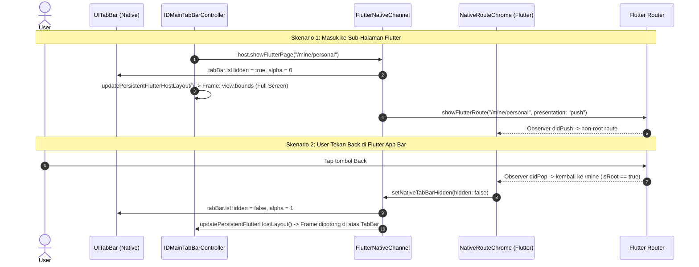

# 05 — Arsitektur Navigasi Hybrid TabBar & Flutter Persistent Host

> **Dokumen Modul:** [`05-hybrid-tabbar-navigation.html`](file:///Users/samir/Documents/Workspace/Chiron/courses/samir-mobile-ios/04-understanding-navigation/05-hybrid-tabbar-navigation.html)  
> **Modul Kurikulum:** Level 4 — Understanding Navigation  
> **Target Audiens:** Middle to Senior iOS / Mobile Engineer  
> **Cakupan Kode:** `IDMainTabBarController.swift`, `FlutterEngineManager.swift`, `FlutterNativeChannel.swift`, `FlutterNativeChannel+route.swift`, `flutter_native_route_dispatcher.dart`, `native_route_chrome.dart`, `flutter_root_page.dart`

---

## 1. Ikhtisar & Koreksi Konseptual

Di aplikasi SAMIR Mobile iOS, sekilas terlihat seolah-olah Native dan Flutter sama-sama memiliki bottom navigation bar (TabBar). Namun pada implementasi sebenarnya:

> **Fakta Arsitektur:** **Hanya ada 1 TabBar fisik di layar, yaitu Native `UITabBar`**.

Aplikasi menggunakan pola arsitektur **Single Persistent Flutter Host (Overlay Pattern)**:
- **`UITabBarController` Native** bertindak sebagai master container utama dengan 3 tab item:
  - Tab 0: `IDHomeViewController` (**Native UIKit murni**)
  - Tab 1: `IDRepayViewController` (**Native Sentinel / Placeholder VC**)
  - Tab 2: `IDMineViewController` (**Native Sentinel / Placeholder VC**)
- **Instance Tunggal `FlutterEngine` & `SamirFlutterViewController`** dijalankan sejak awal aplikasi (*prewarmed*).
- View Flutter tersebut diletakkan di dalam `flutterContainerView` dan disisipkan di atas view native tetapi **tepat di bawah `tabBar`**:
  ```swift
  view.insertSubview(flutterContainerView, belowSubview: tabBar)
  view.bringSubviewToFront(tabBar)
  ```
- Di sisi Flutter, halamannya tidak merender bottom navigation bar tersendiri, melainkan menampilkan kontainer `IndexedStack` yang memuat `MineHomePage` (`/mine`) dan `RepayHomePage` (`/repay`).

---

## 2. Mengapa Arsitektur Ini Dipilih? (Tradeoff Analysis)

| Dimensi | Pendekatan Multi-Engine (Tab Terpisah) | Pendekatan Single Persistent Host (SAMIR iOS) |
| :--- | :--- | :--- |
| **Konsumsi Memori (RAM)** | ❌ **Boros.** Butuh 2–3 `FlutterEngine` aktif (~35–45 MB per engine = total > 100 MB). | ✅ **Hemat.** Hanya 1 `FlutterEngine` dipakai bersama (~35 MB overhead tetap). |
| **Kecepatan Switch Tab** | ⚠️ Lambat jika engine dibuat *on-demand*, atau boros baterai jika semua standby. | ✅ **Instan.** Flutter hanya mengganti index di `IndexedStack`. |
| **Native Look & Feel** | ⚠️ Sulit menyelaraskan haptic feedback, safe-area layout, dan animasi tab bar iOS jika dirender di Flutter. | ✅ **100% Native iOS `UITabBar`** dengan transisi native Apple standar. |
| **Kompleksitas Sinkronisasi** | ⚠️ Tiap engine punya isolate Dart terpisah; sinkronisasi state antar-tab sangat rumit. | ⚠️ Butuh koordinasi view geometry (`updatePersistentFlutterHostLayout`) & bridging router manual. |

---

## 3. Pembedahan `showRoot` vs `showPage`

Dua method ini memiliki tanggung jawab arsitektural yang berbeda secara mendasar:

```
                          ┌───────────────────────────┐
                          │   FlutterEngineManager    │
                          └─────────────┬─────────────┘
                                        │
                 ┌──────────────────────┴──────────────────────┐
                 ▼                                             ▼
       showRoot(route, reqId)                      showPage(route, "push")
       ──────────────────────                      ───────────────────────
       • Ganti Tab Root Flutter                    • Buka Sub-Halaman Baru
       • Target: IndexedStack                      • Target: Navigator Stack
       • Sinkron (tunggu frameReady)               • Asinkron (Fire & Forget)
       • requestID anti race-condition             • TabBar native disembunyikan
       • TabBar native tetap tampil                • Contoh: /mine/personal
       • Contoh: /mine atau /repay
```

### A. `FlutterEngineManager.shared.showRoot`
Digunakan ketika user menekan tab bar native (Tagihan atau Saya).
1. **Tidak Menumpuk History:** Mengubah `FlutterRootController.selectedPath` di Flutter yang memicu render pada `IndexedStack`.
2. **Anti-Flicker (`frameReady`):** Native tidak langsung menampilkan view Flutter. Flutter merender frame terlebih dahulu:
   ```dart
   WidgetsBinding.instance.ensureVisualUpdate();
   await WidgetsBinding.instance.endOfFrame;
   ```
   Setelah frame selesai digambar GPU, Flutter membalas `{ frameReady: true, requestId: id }`. Baru saat itulah `flutterContainerView.isHidden = false` dipasang di native.
3. **Anti-Race Condition (`requestID`):** Menggunakan monotonic integer counter statis `nextFlutterRootRequestID`. Jika user menekan Tagihan &rarr; Saya &rarr; Tagihan dalam tempo kilat, respons render dari tab "Saya" yang datang terlambat akan ditolak karena ID-nya tidak cocok dengan `flutterRootRequestID` aktif.

### B. `FlutterEngineManager.shared.showPage`
Digunakan saat native ingin membuka sub-halaman formulir/detail di Flutter:
```swift
host.showFlutterPage("/mine/personal", presentation: "push")
```
1. **Navigasi Stack:** Memanggil `Routers.push(route)` di Flutter.
2. **Otomatis Sembunyikan TabBar:** `NativeRouteChrome` di Flutter mendeteksi perpindahan ke rute non-root, lalu mengirim channel event `setNativeTabBarHidden(true)`. Native mengubah `tabBar.isHidden = true` dan memperluas frame Flutter menjadi layar penuh (`view.bounds`).
3. **Nilai `presentation`:**
   - `"push"` (default): Animasi slide horizontal standar ke stack navigator.
   - `"replace"`: Menggantikan halaman saat ini (`Routers.go`) tanpa menumpuk tombol Back.

### C. 💡 Mental Model Kunci: Analogi `hidesBottomBarWhenPushed` iOS Native

Cara paling sederhana dan intuitif memahami perbedaan ini dari sudut pandang iOS Engineer:

> **Ringkasan Mental Model:**  
> - **`showRoot` (Mode Tab):** Karena pengguna masih berada di level tab utama, mereka **masih membutuhkan TabBar native** untuk berpindah tab &rarr; TabBar **TIDAK di-hide**, dan tinggi layar Flutter dibatasi tepat di atas TabBar.
> - **`showPage` (Mode Halaman Anak / Full-Screen):** Pengguna masuk ke halaman detail/formulir, sehingga ekspektasi UX adalah **tampilan layar penuh** &rarr; TabBar native **WAJIB di-hide**, dan frame Flutter diperluas 100% memenuhi layar (`view.bounds`). Navigasi kembali diserahkan ke tombol Back di AppBar.

Pada aplikasi iOS UIKit konvensional, perilaku `showPage` ini setara persis dengan menyetel:
```swift
childViewController.hidesBottomBarWhenPushed = true
```
Namun karena Flutter berjalan di atas satu View Controller persisten yang sama (*Single Persistent Flutter Host*), efek tersebut disimulasikan secara dinamis melalui sinyal Platform Channel `setNativeTabBarHidden = true`.

---

## 4. Mekanisme Dynamic Chrome & TabBar Visibility

Perhatikan alur visibilitas tab bar di file `IDMainTabBarController.swift` dan `FlutterNativeChannel+route.swift`:



---

## 5. Mengapa `showFlutterPage` di TabBar Hanya Menerima `/mine`?

Pada `IDMainTabBarController.swift:L169-L183`:
```swift
public func showFlutterPage(_ route: String, presentation: String = "push") {
    guard let tabViewControllers = viewControllers,
          tabViewControllers.indices.contains(2) else { return }
    let mineTab = tabViewControllers[2]
    selectedViewController = mineTab
    FlutterNativeChannel.shared.nativeTabBarHidden = true
    currentFlutterRoot = "/mine"
    ...
    FlutterEngineManager.shared.showPage(route, presentation: presentation)
}
```

Alasan desain bisnis:
1. **Satu-satunya sub-halaman Flutter dari luar adalah milik Tab "Saya":** Halaman seperti `/mine/personal` (Info Pribadi & Auth) adalah modul di bawah Tab Saya. Jika user membuka halaman ini lalu menekan tombol Back sampai habis, konteks yang harus tampil adalah Tab "Saya".
2. **Tab "Tagihan" (`/repay`) adalah Single Page Tab:** Halaman tagihan di Flutter tidak memiliki sub-alur Flutter anak. Transaksi pinjaman, pelunasan, pembayaran VA, dan rincian bunga di-*delegate* kembali ke modul Native (`IDRouterManager`) atau WebView H5 (`IDBusinessWebViewController`).

---

## 6. Peta Komunikasi Lengkap (Navigasi Dua Arah)

### A. Native &rarr; Flutter
1. **Tab Switch:** `IDMainTabBarController.switchFlutterRoot(to:)` &rarr; `FlutterEngineManager.showRoot` &rarr; MethodChannel `"showFlutterRoute"` (`presentation: "root"`).
2. **Sub-Page Navigation:** `IDSamirMineRouterHandler` &rarr; `IDMainTabBarController.showFlutterPage` &rarr; MethodChannel `"showFlutterRoute"` (`presentation: "push"`).
3. **Data Refresh Signals:** `FlutterEngineManager.refreshMineHome()` & `refreshRepayHome()`.

### B. Flutter &rarr; Native
1. **Buka Rute Native / Scheme / External:** `FlutterNativeChannelRoute.openNativeRoute(url, params)` &rarr; `FlutterNativeChannel+route.swift` mengevaluasi:
   - External URL / Medsos: `UIApplication.shared.open`
   - Layanan H5 Web: `IDBusinessWebViewController.loadUrlWithAuth`
   - Aksi Native: `customerAction`, `repayLoginAction`, `jumpDisclaimerPopup`
   - Native Router Scheme: `IDRouterManager.id_perfromWithURLString`
2. **Tutup Halaman Flutter:** `FlutterNativeChannelRoute.closeFlutterPage()` &rarr; Native memanggil `topViewController?.navigationController?.popViewController()` atau `dismiss()`.
3. **Kontrol TabBar:** `FlutterNativeChannelRoute.setNativeTabBarHidden(hidden)`.

---

## 7. Gotchas & Debugging Checklist

1. **TabBar Hilang Setelah Kembali dari Flutter:**
   - *Penyebab:* Callback observer di Flutter tidak terpanggil atau route name tidak terdaftar di `RootRoutes.tabPaths`.
   - *Mitigasi:* Pastikan rute root terdaftar di `RootRoutes.paths` dan panggil `prepareNativeChromeForTabSelection()` setiap kali tab native dipilih.
2. **Layar Flutter Kosong (Blank/Stuck):**
   - *Penyebab:* Lifecycle engine masih dalam status `inactive` atau request ID tidak sinkron dengan response completion.
   - *Mitigasi:* Periksa apakah `FlutterEngineManager.shared.resume()` dipanggil sebelum `showFlutterRoute`.
3. **Safe Area Inset Terpotong:**
   - *Penyebab:* Perhitungan safe area guide native tidak dikirim ke Flutter saat tinggi tab bar berubah.
   - *Mitigasi:* Verifikasi fungsi `updatePersistentSafeArea(top:bottom:)` di `SamirFlutterViewController`.
